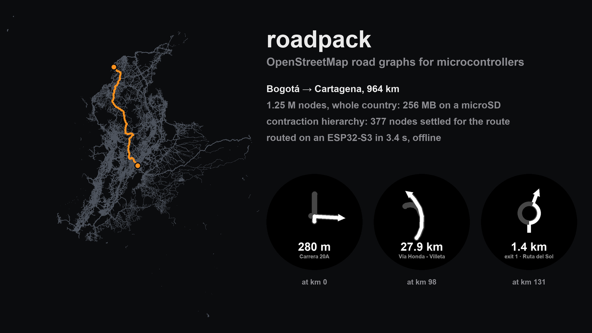

# roadpack

[](https://github.com/NicolasDevel/roadpack/actions/workflows/tests.yml)
[](LICENSE)


**Turn-by-turn routing on a microcontroller, offline, for a whole country.**

roadpack compiles an OpenStreetMap extract into a `.gmap`: a compact binary road graph with a precomputed
**contraction hierarchy**, laid out so that a device with a few MB of RAM routes straight from a microSD card,
without ever loading the map. All of Colombia is 256 MB, turn restrictions included, and an ESP32-S3 finds the 963 km
route from Bogotá to Cartagena in under 3 seconds, with a cold cache ([on the device](#on-the-device)).

[Leer en español](README.es.md)



## Why

Routing engines like OSRM, Valhalla or GraphHopper are built for servers and phones, with an operating system, a
file system and plenty of memory. A microcontroller has a few MB of RAM, a FAT-formatted SD card that reads a few
MB per second, and no operating system. roadpack is not a routing engine: it is the build step that produces a
map such a device can route on.

- **Only what routing needs.** Drivable roads for a vehicle profile; graph nodes only at intersections and dead
  ends (13 to 47 % of the OSM road nodes); shapes simplified to 2 m.
- **Few nodes per route.** The contraction hierarchy settles a few hundred nodes for a route across a country,
  where A* settles hundreds of thousands (Colombia: 275 against 458,000, median of 200 random routes).
- **Read in place.** Fixed-size little-endian records, nodes in Z-order so that nearby roads sit in the same SD
  card pages, a sparse spatial grid to snap a GPS fix, and the file split into 4 MiB chunks because FAT without
  fast seek is slow on large files.
- **Verified.** The hierarchy matches A* on 2,200 random routes across 22 regions, and the builder's output is
  checked against the original reference implementation ([how](docs/SCALING.md)).

It was built for, and runs on, an offline motorcycle navigator: a Waveshare ESP32-S3 with a 466×466 round AMOLED
display, reading the map from a microSD card.

## Quick start

```bash
pip install git+https://github.com/NicolasDevel/roadpack.git

# Any extract from https://download.geofabrik.de or https://extract.bbbike.org
roadpack build colombia-latest.osm.pbf -o out/colombia.gmap                 # the whole extract
roadpack build colombia-latest.osm.pbf --region bogota -o out/bogota.gmap   # or --bbox minlat,minlon,maxlat,maxlon

roadpack info  out/bogota.gmap
roadpack route out/bogota.gmap --from 4.5981,-74.0760 --to 4.6766,-74.0482 --check --images out/preview
roadpack stats out/bogota.gmap --routes 200
```

```
Route: 13.9 km, ~19 min, 155 edges, 11 maneuvers
  contraction hierarchy settled 293 nodes in 1 ms (Python)
  A* on the full graph settled 19,263 nodes in 30 ms: same cost

    0.00 km  (+    0 m)  Head out onto Calle 11
    0.55 km  (+  550 m)  Turn left onto Avenida Calle 7
    0.67 km  (+  120 m)  Turn left onto Carrera 5
   ...
```

- `build` writes the `.gmap` and the same file split into chunks for the SD card (`out/bogota/0000.bin`, …).
  `--profile car` applies car access and one-way rules instead of motorcycle ones.
- `route` routes like a device would and prints the maneuvers; `--check` compares with A* on the full graph,
  `--images` renders the route and each maneuver screen.
- `stats` routes between random pairs of nodes and reports the nodes settled and the KB of the file each route
  reads, which is what the SD card has to deliver.

The first build fetches [RoutingKit](https://github.com/RoutingKit/RoutingKit) and compiles a small helper into
`~/.cache/roadpack`: it needs `git` and a C++17 compiler.

## How it works

```mermaid
flowchart LR
    pbf[".osm.pbf"] --> load["Load<br/>highway ways, then their nodes<br/>(two passes, filtered in C++)"]
    load --> graph["Graph<br/>split at intersections<br/>simplify shapes · Z-order<br/>spatial grid<br/>turn restrictions"]
    graph --> ch["Contraction hierarchy<br/>(RoutingKit)"]
    ch --> gmap[".gmap<br/>+ 4 MiB chunks"]
    gmap --> sd["microSD"] --> mcu["Microcontroller<br/>bidirectional upward Dijkstra<br/>through a small page cache"]
```

```
┌────────┬────────────┬──────────┬──────────────┬──────────┬───────┬────────────┬─────────────┐
│ header │ nodes      │ edges    │ spatial grid │ geometry │ names │ CH forward │ CH backward │ copies   │
│ 80 B   │ 12 B × N+1 │ 28 B × E │ sparse       │ variable │ UTF-8 │            │             │ 8 B × K  │
└────────┴────────────┴──────────┴──────────────┴──────────┴───────┴────────────┴─────────────┴──────────┘
```

A device answers a query by running Dijkstra from both ends, only ever going up in the hierarchy, then unpacking
the shortcuts into real edges. The format, byte by byte, and the query are in [FORMAT.md](FORMAT.md); the Python
reader in `roadpack.format` and the router in `roadpack.routing` are the reference implementation.

## Results

From the [benchmarks](benchmarks/README.md): motorcycle profile, 200 random routes per region, on a 16 GB laptop.

| Region | Graph nodes | `.gmap` | Build | Median route | Nodes settled (median) | A* settles | KB read per query |
|---|---:|---:|---:|---:|---:|---:|---:|
| Bogotá | 91 k | 15 MB | 5 s | 15 km | 272 | 29 k | 1,072 |
| London | 419 k | 62 MB | 11 s | 31 km | 389 | 83 k | 2,040 |
| Tokyo | 236 k | 42 MB | 7 s | 17 km | 462 | 81 k | 2,112 |
| Colombia | 1.27 M | 263 MB | 54 s | 610 km | 294 | 439 k | 2,972 |
| Spain | 3.41 M | 603 MB | 2 min | 563 km | 420 | 545 k | 3,560 |
| California | 2.94 M | 505 MB | 95 s | 408 km | 566 | 1.09 M | 4,496 |
| Brazil | 10.2 M | 2.2 GB | 8 min | 1,674 km | 693 | 3.59 M | 8,020 |

The benchmarks also cover Mexico City, Lima, Buenos Aires, Santiago, Washington DC, Ottawa, Toronto, New York,
Madrid, Barcelona, Paris, Berlin, Canada, Texas, New York State and Colombia by department.
[How large countries fit in a laptop, and the evidence that they are exact](docs/SCALING.md).

## On the device

Measured on the navigator this was built for: an ESP32-S3 with a 2 MB page cache in PSRAM (4 KiB pages), reading
the Colombia map (v3, with turn restrictions; OSM data of 2026-10-27) from a microSD card in 1-bit mode at
40 MHz, with the cache empty before each route. Median of 10 runs.

| Route | Distance | Route found | Ready to navigate | SD card reads |
|---|---:|---:|---:|---:|
| Across Bogotá | 15 km | 0.9 s | 1.4 s | 423 |
| Bogotá – San Francisco | 62 km | 1.0 s | 1.4 s | 464 |
| Bogotá – Medellín | 427 km | 2.0 s | 2.5 s | 839 |
| Bogotá – Cartagena | 963 km | 2.9 s | 3.4 s | 1,139 |

*Route found* is the hierarchy query plus unpacking the shortcuts into edges. *Ready to navigate* adds the
shapes and maneuvers of the first 15 km.

What made the difference:

- **The time is spent waiting for the card.** Each random 4 KiB read costs about 2.8 ms and the computation is
  negligible, so the number to watch is reads per route (what `roadpack stats` reports). Larger pages were slower:
  the cost grows with the bytes read.
- **Build the shapes as you go.** Reading the shapes and checking every intersection of a 963 km route costs more
  than finding it (1,352 reads), so the navigator only builds 15 km ahead of the rider. Bogotá–Cartagena went from
  8.2 to 4.4 s. Adding up the length of the rest of the route while riding, instead of before showing it, saved
  another ~400 reads: until then the remaining distance is estimated from the travel time of the edges.
- **Use a genuine card.** A counterfeit one (sold as a known brand, but its CID reports manufacturer 0x6F)
  stalled for about 9 s in one route out of three and sometimes failed a read even after retries. A failed read
  silently leaves zeros where the data should be, so the device counts them and computes the route again. The same
  card once stored a copy of the map with 16 KB of one chunk replaced by other data, without any error: compare
  the files after copying them to the card.

## Limits

- The `.gmap` format addresses 4 GiB and about 164° of longitude: Brazil fits (2.2 GB); the whole United
  States does not, so it is built per state.
- Building needs at least about 1.5 GB of RAM, and about 9 GB for Brazil.
- Turn restrictions with a via node are applied (in Colombia, 5,913 of 7,125); those with a via way and the
  time-dependent ones are not. Speeds come from `maxspeed` or a default per road class (no traffic).
- The microcontroller side is specified in FORMAT.md and implemented in Python here; a portable C reader is
  planned.

## Project layout

| Module | Layer |
|---|---|
| `roadpack.osm` | Loading: drivable ways of an OSM extract for a vehicle profile (`motorcycle`, `car`) |
| `roadpack.graph` | Graph: segments between intersections, simplified geometry, Z-order, spatial grid (numpy) |
| `roadpack.ch` | Contraction hierarchy (RoutingKit, `build_ch.cpp`) |
| `roadpack.format` | The `.gmap` format: writer, reader, SD card chunks |
| `roadpack.routing` | Reference routing: CH query, A*, turn-by-turn maneuvers |
| `roadpack.stats`, `roadpack.preview` | Route sampling; PNG of a route and of each maneuver screen |
| `benchmarks/` | Benchmark, validation and reference-comparison scripts, with their results |

```bash
pip install -e '.[test]' && pytest
```

The tests build small synthetic OpenStreetMap files (a hand-made town that exercises every rule, and random
street grids) and check, among other things, that the contraction hierarchy matches Dijkstra on every pair of
nodes.

## Licenses

- This repository's code: [MIT](LICENSE).
- Generated maps are a database derived from OpenStreetMap, © OpenStreetMap contributors, under the
  [ODbL](https://opendatacommons.org/licenses/odbl/): if you distribute them, give that attribution and share
  them under the same license.
- [RoutingKit](https://github.com/RoutingKit/RoutingKit) (BSD 2-Clause) is downloaded and compiled on use; it
  is not included in this repository.
- Python dependencies: [pyosmium](https://github.com/osmcode/pyosmium) (BSD 2-Clause),
  [NumPy](https://numpy.org) (BSD 3-Clause), [Pillow](https://python-pillow.org) (MIT-CMU).
